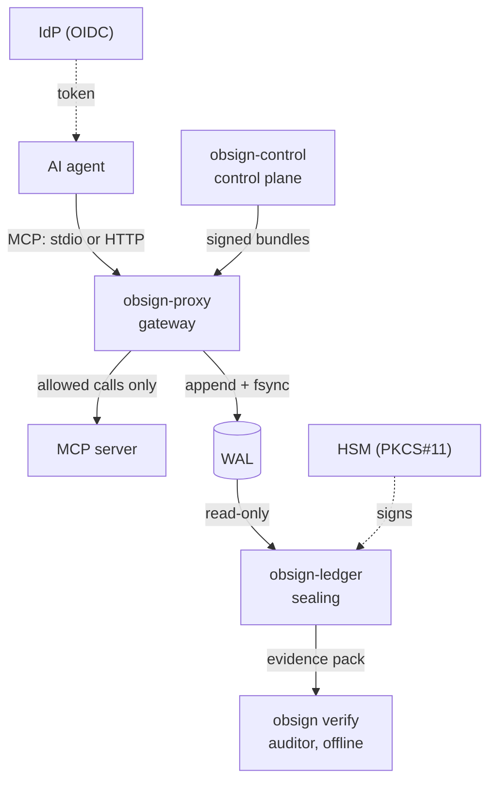
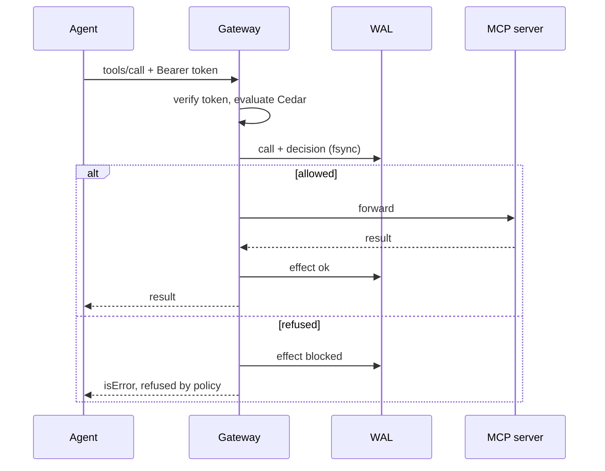
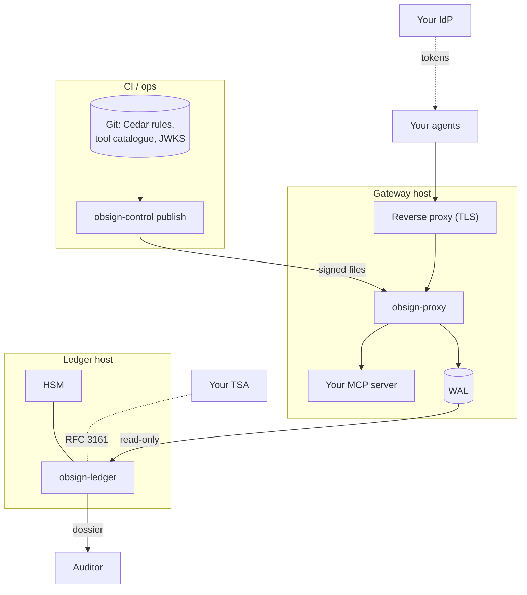

# Obsign

**Verifiable proof of what your AI agents did to your systems.**

Obsign sits between your agents and their MCP servers. It checks every act
against a signed Cedar policy and records who delegated, which agent acted,
which tool it called and the verdict, in a sealed log. An auditor verifies
that log **offline**, without access to your infrastructure or ours.

> Observability answers "what happened?" for fifteen days. Obsign answers
> "prove it", twenty-four months later, to someone with no reason to believe you.

| The auditor asks | The evidence pack answers with |
|---|---|
| Who authorized it? | The human behind the OIDC token, verified, plus the RFC 8693 actor chain (`agent → human`, or `machine`) |
| What was attempted? | Tool, resource or prompt, with the hash of its arguments (values are never stored) |
| Was it allowed? | The Cedar verdict, the rule's `@id` and the policy version (`policies@<git sha>`) |
| Can the log have been rewritten? | No: hash chain, per-record gateway signature, checkpoints sealed by a key the gateway never holds (HSM), optional RFC 3161 timestamp |
| Who can check it? | Anyone, offline, with one binary: `obsign verify` → exit `0` proven, `1` tampered, `3` consistent but unproven |

## Architecture

<table>
<tr>
<td width="58%">



</td>
<td>

**Four binaries, three trust zones.**

- **Gateway**: verifies identity, evaluates the policy, writes and `fsync`s
  the record *before* forwarding. Holds no sealing key.
- **Ledger**: runs on another host, reads the WAL, refuses a rewritten one,
  seals checkpoints through an HSM.
- **Control plane**: compiles policies from git into signed, immutable
  releases.
- **Verifier**: the only binary the auditor needs. No network, no trust in
  you.

A fifth, `obsign-tpm-enroll`, runs once per gateway host to bind its key
to a TPM; it is a tool, not a service.

</td>
</tr>
<tr>
<td colspan="2">



</td>
</tr>
<tr>
<td>

**Durable before forwarded.** The record is on disk before the call leaves.
A crash in between leaves a trace of an act that never happened, never an
act without a trace.

A refused call never reaches the server. Tools the signed catalogue does not
describe are hidden from `tools/list` and refused, even when the server
advertises them.

</td>
<td>

**Default-deny.** Arbitrated: `tools/call`, `resources/read`, `prompts/get`, subscriptions,
completions, server-initiated `sampling` and `elicitation`. Protocol machinery
(`initialize`, `ping`, listings) is relayed; any other method is refused and
recorded.

</td>
</tr>
</table>

| Component | Binary | Role |
|---|---|---|
| [`obsign-proxy`](crates/obsign-proxy) | `obsign-proxy` | MCP gateway (stdio and Streamable HTTP), policy enforcement, WAL writer |
| [`obsign-ledger`](crates/obsign-ledger) | `obsign-ledger` | Sealing, divergence detection, RFC 3161 anchoring, evidence export |
| [`obsign-control-plane`](crates/obsign-control-plane) | `obsign-control` | Policy compilation from git, signed releases, audit dossier, read-only console |
| [`obsign`](crates/obsign) | `obsign` | Offline verifier |
| [`obsign-audit-core`](crates/obsign-audit-core) | | Record format, hash chain, Merkle, verification: the only place a hash is computed |
| [`obsign-policy`](crates/obsign-policy) · [`obsign-identity`](crates/obsign-identity) · [`obsign-wal`](crates/obsign-wal) | | Cedar evaluation and signed bundles · OIDC and delegation · durable log |
| [`obsign-pkcs11`](crates/obsign-pkcs11) · [`obsign-tpm-enroll`](crates/obsign-tpm-enroll) | `obsign-tpm-enroll` | HSM signing · TPM 2.0 gateway attestation |

## Integrating with your information system

<table>
<tr>
<td colspan="2">



</td>
</tr>
<tr>
<td width="50%">

**Everything arrives as a signed file.** The gateway and the ledger make no
outbound network calls: no JWKS fetch, no ledger round trip, no HTTP client
for timestamping. Air-gapped deployment is the default case, not a special
one.

</td>
<td>

**Policy is code.** A rule change is a reviewed pull request, and every
decision in the log cites the git sha of the policies it applied.

The WAL is the only surface the gateway and the ledger share. The gateway
can write it but cannot seal it; the ledger can seal but cannot write it.

</td>
</tr>
</table>

| Your system | How Obsign connects | Guide |
|---|---|---|
| **Identity provider**: Keycloak, Entra ID, Okta, Ping | Standard OIDC, no connector per product. JWKS and claim mapping live in a signed identity bundle; key rotation reloads it from disk | [identity.md](docs/identity.md) |
| **Git** | Policies, tool catalogue and JWKS are a repository; `obsign-control publish` compiles, type-checks and signs them | [policies-cedar.md](docs/policies-cedar.md) · [reference](docs/policy-source-reference.md) |
| **MCP servers** | The gateway wraps each one as a child process; agents connect over stdio or Streamable HTTP | [deploy-docker.md](docs/deploy-docker.md) |
| **Reverse proxy**: nginx, Caddy | Terminates TLS in front of the gateway's plaintext HTTP port | [deploy-tls.md](docs/deploy-tls.md) |
| **HSM / smartcard** | Vendor PKCS#11 module loaded by the ledger; the sealing key never leaves it | [walkthrough](docs/walkthrough.md#sealing-through-an-hsm-pkcs11) |
| **Timestamping authority** | RFC 3161, exchanged by file | [walkthrough](docs/walkthrough.md#rfc-3161-anchoring) |
| **TPM 2.0** | Proves which gateway binary held the signing key | [attestation](docs/design/attestation-v3.md) · [real TPM](docs/real-tpm-interop.md) |
| **Supervision** | The ledger exits non-zero on a rewritten WAL; systemd `OnFailure=` raises the alert | [alerting.md](docs/alerting.md) |
| **Backup** | WAL and checkpoint store, long-term retention | [runbook](docs/runbook-backup-restore.md) |

**Rollout in six steps**

1. Put your Cedar rules, tool catalogue and IdP JWKS in a git repository.
2. Publish a signed release: `obsign-control publish --source <repo> --key <ops key> --key-id <id> --dist <dir>`.
3. Deploy the gateway image in front of each MCP server, with the bundles mounted read-only.
4. Terminate TLS in a reverse proxy; keep the gateway port on loopback.
5. Run the ledger on a separate host, WAL mounted read-only, key in an HSM.
6. Each period, export the dossier (`obsign-control export`) and hand it to the auditor with your public keys.

## Quickstart

With Docker, the full pipeline (gateway, ledger, offline verification) in containers:

```bash
docker compose up -d gateway console
docker compose run --rm demo    # drives the gateway, seals, verifies: exit 0
```

From source, the verifier detecting tampering:

```bash
cargo run -p obsign-audit-core --example gen_sample -- /tmp/sample
cargo run -p obsign -- verify /tmp/sample/evidence.json --trusted-keys /tmp/sample/trusted-keys.json  # exit 0
sed -i '' 's/"outcome": "deny"/"outcome": "allow"/' /tmp/sample/evidence.json   # GNU sed: drop ''
cargo run -p obsign -- verify /tmp/sample/evidence.json --trusted-keys /tmp/sample/trusted-keys.json  # exit 1
```

Changing one field breaks three things held by three different keys: the hash
chain, the gateway's signature on the record, and the sealed Merkle root.

The [walkthrough](docs/walkthrough.md) runs everything step by step: a
destructive call refused, a tool allowed or refused depending on one of its
arguments, the HTTP transport, sealing, HSM, anchoring, publishing and the
console.

## Invariants

Each of these is a reason to refuse a pull request:

| Invariant | Why |
|---|---|
| Frozen record format | Changing an encoding invalidates every log already sealed |
| `obsign-audit-core` is the only proof implementation | Two implementations would eventually disagree on what is valid |
| No JSON in hashes | JSON allows two encodings of the same data; the canonical encoding does not |
| No network calls in the gateway | Air-gap compatible, no outbound surface to justify in review |
| Everything that authorizes is signed | Policy, identity, catalogue, deployment: whoever writes an unsigned file mints authority |
| `fsync` before forwarding | An act without a trace would ruin the product |
| Degradations stay visible | What is not proven is reported as such, and keeps the run off exit 0 |

## Documentation

| | |
|---|---|
| **Understand** | [Walkthrough](docs/walkthrough.md) · [Identity and delegation](docs/identity.md) · [Design notes](docs/design-notes.md) (decisions, format compatibility, known debt, tests) |
| **Write policies** | [Cedar policies](docs/policies-cedar.md) · [Source tree reference](docs/policy-source-reference.md) |
| **Deploy and operate** | [Docker](docs/deploy-docker.md) · [TLS](docs/deploy-tls.md) · [Alerting](docs/alerting.md) · [Backup and restore](docs/runbook-backup-restore.md) · [Real TPM](docs/real-tpm-interop.md) |
| **Design specs** | [WAL origin auth](docs/design/wal-origin-auth.md) · [Deployment bundle](docs/design/deployment-bundle-v1.md) · [Session certs](docs/design/session-certs-v2.md) · [Attestation](docs/design/attestation-v3.md) · [Argument policy](docs/design/argument-policy-v1.md) |

## Build and test

```bash
cargo build --workspace    # Rust 1.99.1 (pinned) + cmake for the gateway's JWT backend
cargo test --workspace
cargo build -p obsign      # the auditor's verifier: rustup only, no cmake
```

Docker images (gateway, ledger, control plane, verifier) are distroless,
multi-arch, cosign-signed and published to `ghcr.io/obsign` on every tag.

## License

Apache-2.0, see [LICENSE](LICENSE). Contributions under the
[DCO](https://developercertificate.org/), see [CONTRIBUTING.md](CONTRIBUTING.md).
Report vulnerabilities privately, see [SECURITY.md](SECURITY.md).

The commercial layer (compliance report packs, console RBAC/SSO, long
retention) is separate code under a separate license. This repository is
complete and verifiable without it.
